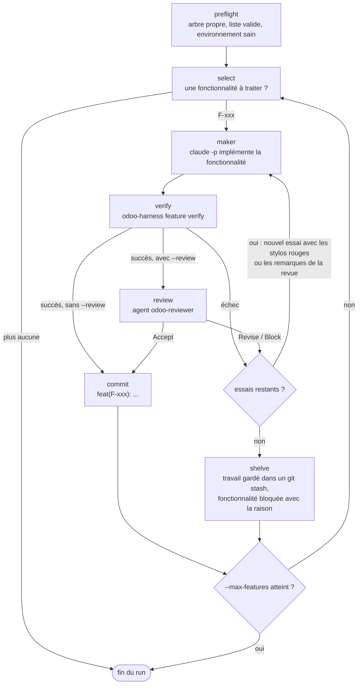

# claude-odoo-harness

Un harness [Claude Code](https://claude.com/claude-code) pour les projets Odoo, basé sur
[Learn Harness Engineering](https://walkinglabs.github.io/learn-harness-engineering/fr/).

> 🇬🇧 [English version](README.md)

Le harness est le système de travail autour du modèle. Il rend Claude fiable sur les
projets Odoo longs : l'état vit dans le dépôt, une seule fonctionnalité est faite à la
fois, et seul le harness peut déclarer une fonctionnalité terminée, après une vraie
vérification.

## Installation

**Une fois par machine**, un seul plugin pour toutes les versions d'Odoo (17.0 à 20.0) :

```
/plugin marketplace add yessin-fogits/claude-odoo-harness@main
/plugin install odoo-harness@odoo-harness
```

Installez-le au niveau utilisateur (le choix par défaut) : tous les projets de la machine en
profitent, et une mise à jour du plugin les atteint tous d'un coup. Ensuite, **une fois par
projet**, lancez Claude Code à la racine du dépôt Odoo, ou dans son espace client
(organisation fogits : `~/Project/<client>`, avec le dépôt dans `git/` et Odoo Enterprise dans
`enterprise/`), puis `/odoo-harness:init`. Dans un dépôt Odoo sans harness, la première
session le propose une fois.

Le harness couvre **tout le projet**, nouveau ou déjà développé :

- **Détection** : modules spécifiques, modules tiers (OCA), Enterprise, version et image
  d'Odoo, branche de base, projet GitLab et fichiers de déploiement sont lus dans le projet
  lui-même (`odoo-stag.conf`, `Dockerfile`, git). Vous les confirmez.
- **Découverte d'un projet existant** : `ARCHITECTURE.md` (carte des modules, dépendances,
  risques et dette), une section projet dans `CLAUDE.md`, et les tâches ouvertes du projet
  dans votre Odoo (lues via le connecteur MCP Odoo) proposées comme fonctionnalités.

Puis les 4 étapes d'initialisation :

1. **Environnement exécutable** : l'image du projet, sa propre base PostgreSQL, son port et
   une base de test jetable avec données de démo (jamais votre stack de dev), tous les
   modules spécifiques installés (`odoo-harness init`).
2. **Cadre de test vérifiable** : un test qui passe à chaque niveau (unitaire, intégration, e2e).
3. **Document de contrat d'amorçage** : `BOOTSTRAP.md`, relu par un humain.
4. **Découpage des tâches** : de petites fonctionnalités dans `feature_list.json`, relues par un humain.

`init` propose aussi, une fois par machine, d'autoriser la commande `odoo-harness` dans vos
réglages utilisateur, pour que les sessions de n'importe quel espace client ne demandent pas
la permission à chaque commande. Prérequis : Docker avec le plugin compose, Python 3.10+, git.

Aucune clé SSH n'est nécessaire : le plugin est cloné en HTTPS depuis ce dépôt public.

## Comment c'est réparti

Le moteur est installé une fois par machine ; le dépôt n'en garde aucune copie. Le dépôt
reste la référence de l'équipe : la liste des fonctionnalités, les preuves et PROGRESS.md
sont versionnés avec le code.

| Où | Quoi |
|---|---|
| Le plugin (une fois par machine) | la commande `odoo-harness` et son moteur (cycle des fonctionnalités, vérification en 3 couches, environnement de test, boucle, GitLab, guides, catalogue des stylos rouges, vérifications du harness, fichiers Docker), les hooks, skills et agents |
| Le dépôt Odoo | l'état (`PROGRESS.md`, `DECISIONS.md`, `feature_list.json`, `BOOTSTRAP.md`, `ARCHITECTURE.md`, `harness/evidence/`) et la configuration du projet (`harness/harness.env`, ses propres vérifications et stylos rouges, `e2e/`) |
| `~/.odoo-harness/` | `current`, un lien vers le plugin installé ; le raccourci `~/.local/bin/odoo-harness` passe par lui |

`harness/harness.env` fixe `HARNESS_VERSION`, le moteur le plus ancien que le projet
accepte : un collègue dont le plugin est plus ancien doit le mettre à jour avant que
`odoo-harness` ne s'exécute, pour que tout le monde vérifie avec les mêmes règles. Chaque
preuve enregistre la version du moteur qui l'a produite.

## Ce que vous obtenez dans le dépôt Odoo

| Fichier | Rôle |
|---|---|
| `CLAUDE.md` | Règles de travail (WIP = 1, faire moins mais terminer), règles de la liste de fonctionnalités, définition de « terminé », hiérarchie de validation |
| `PROGRESS.md` | État actuel (réécrit automatiquement), terminé / en cours, problèmes connus, prochaines étapes |
| `DECISIONS.md` | `- date : décision` |
| `ARCHITECTURE.md` | Carte du projet : modules, modèles, dépendances, risques et dette |
| `feature_list.json` | `id`, `behavior`, `verification`, `state`, `evidence`, et la `task` Odoo (`T2003`) ; modifié uniquement par `odoo-harness feature` |
| `harness/harness.env` | Les réglages du harness pour le projet : version et image d'Odoo, dossiers de modules, base de test et port, branche de base, projet GitLab, chemins protégés, `HARNESS_VERSION` |
| `harness/checks/` | Vérifications du projet ; chaque nouveau type d'erreur trouvé en revue en devient une |
| `harness/errors_project.py` | Les stylos rouges du projet : chaque échec affiche POURQUOI et COMMENT CORRIGER |
| `harness/evidence/` | Une preuve par fonctionnalité qui passe |

## La commande `odoo-harness`

Lancez-la depuis le dépôt ou son espace client ; elle trouve le dépôt toute seule.

| Commande | Rôle |
|---|---|
| `odoo-harness init [--check \| --reset]` | L'environnement de test : l'image du projet, sa propre base PostgreSQL et son port, les modules spécifiques installés sur une base jetable, la vérification de référence |
| `odoo-harness feature add \| start \| block \| verify \| check \| status` | Le cycle des fonctionnalités. `start` est refusé si une autre fonctionnalité est en cours et bascule sur la branche de la tâche ; `verify` est le seul chemin vers `passing` |
| `odoo-harness verify` | Trois couches sur les modules modifiés et tous ceux qui en dépendent : vérifications statiques + pylint-odoo (le rcfile du projet), tests Odoo, e2e Playwright avec un log serveur propre. Les problèmes plus anciens sont de la dette, pas des blocages |
| `odoo-harness gitlab mr T2003` | Quand toutes les fonctionnalités de la tâche passent, pousse la branche de la tâche et ouvre sa merge request vers `staging` |
| `odoo-harness guide capture \| build \| check` | Le guide utilisateur en français d'une tâche terminée, à partir des tests e2e rejoués |
| `odoo-harness static [--all]`, `odoo-harness map` | Les vérifications statiques (`--all` : le rapport de dette), la carte du projet |
| `odoo-harness compose ...` | `docker compose` sur la stack du harness (`compose logs odoo`, `compose ps`) |
| `odoo-harness loop run \| status` | La boucle autonome (ci-dessous) |
| `odoo-harness where`, `odoo-harness link` | Le dépôt, le moteur et leurs versions ; recrée le raccourci |

## Ce que le plugin ajoute à Claude Code

- **Sessions automatiques** (hooks) : contexte chargé au début de session (avec la version
  d'Odoo du projet et son guide) ; modifications de la liste de fonctionnalités, des preuves,
  du moteur du harness, du cœur Odoo/Enterprise, des modules tiers,
  des fichiers de déploiement et des bases autres que la base de test refusées, et pas de
  push vers `staging`/`main` ; vérifications statiques après chaque modification ; contrôle
  de l'état propre à la fin de chaque tour.
- **Skills** : `init`, `update` (rafraîchir les fichiers du harness du projet, ou migrer un
  projet depuis l'ancien harness copié), `add-harness-check`, `guide`, et `odoo` : la
  référence Odoo avec un guide par version (ORM, vues, sécurité, OWL, contrôleurs, tests,
  migrations, notes de version), écrite à partir du vrai code `odoo/odoo` et vérifiée contre
  lui en CI. Le contexte de session indique le guide de la version du projet.
- **Agents** : `odoo-reviewer` (grille d'évaluation + checklist Odoo, propose de nouvelles
  vérifications) et `odoo-explorer` (trouve les définitions parentes dans le code Odoo de
  votre version).

## Boucle autonome

`odoo-harness loop run` avance seul dans `feature_list.json`, avec Claude Code sans
interface, sous forme de graphe producteur-vérificateur :



Chaque étape :

1. **preflight** : l'arbre de travail est propre, `feature.py check` passe et l'environnement est sain.
2. **select** : la fonctionnalité en cours, sinon la première `not_started`.
3. **maker** : une session Claude Code sans interface (`claude -p`) implémente la fonctionnalité.
4. **verify** : `odoo-harness feature verify` lance les 3 couches ; c'est le seul juge du « fini ».
5. **review** (avec `--review`) : l'agent `odoo-reviewer`, dans un contexte neuf, doit répondre Accept.
6. **commit** du travail vérifié, ou **shelve** quand les essais sont épuisés.

- Le producteur ne juge jamais son propre travail : seul `feature.py verify` peut passer une
  fonctionnalité en `passing`, et `--review` ajoute l'agent `odoo-reviewer` comme second
  vérificateur indépendant.
- Seul le travail vérifié est commité. Le travail en échec est gardé dans un `git stash`
  nommé et la fonctionnalité est bloquée avec la raison et le nom du stash dans PROGRESS.md.
- Budgets : `--max-features` (1 par défaut, pour qu'un humain relise chaque fonctionnalité),
  `--attempts` (3 par défaut), `--max-turns` et `--max-budget-usd` par appel d'agent, `--timeout`.
- `--branch loop/<nom>` travaille sur une nouvelle branche. Journaux et sorties des agents :
  `.harness/loop/<run>/` ; dernier résumé : `odoo-harness loop status`.
- Prérequis : un arbre de travail propre, une base saine (`odoo-harness init --check`), et la
  commande `claude` connectée avec le plugin installé.

## Collaborateurs

Chaque personne installe le plugin une fois sur sa machine :

```
claude plugin install odoo-harness@odoo-harness
```

Le `.claude/settings.json` du dépôt active le plugin et sa marketplace : Claude Code le
propose à quiconque ouvre le dépôt sans l'avoir. Un clone neuf n'a besoin de rien d'autre :
les fichiers du harness sont versionnés, et rien n'est généré dans l'espace client.

## Mise à jour

**Le plugin** (moteur, hooks, skills, agents). La marketplace `odoo-harness` se met à jour
automatiquement : Claude Code met le plugin à jour en arrière-plan, pour tous les projets à la
fois, et vous demande de lancer `/reload-plugins`. Pour mettre à jour tout de suite :

```
claude plugin update odoo-harness@odoo-harness
```

ou `/plugin` → **Installed** → `odoo-harness` → **Update now**. Pour arrêter les mises à jour
automatiques : `/plugin` → **Marketplaces** → `odoo-harness` → **Disable auto-update**.

**Les fichiers du harness d'un projet** (le bloc CLAUDE.md, les réglages, la version fixée).
Lancez `/odoo-harness:update` dans le projet quand le plugin a changé ses modèles, ou pour
relever le `HARNESS_VERSION` du projet. Il garde l'état du projet (PROGRESS.md, DECISIONS.md,
feature_list.json, BOOTSTRAP.md) et sa configuration (harness/harness.env, e2e/conftest.py,
harness/errors_project.py, harness/checks/), montre comment les modèles des fichiers gardés
ont changé, lance les vérifications et note la mise à jour. Commitez le résultat.

**Un projet installé avant la 2.0** (un plugin par version d'Odoo, le moteur copié dans
`harness/`). Installez `odoo-harness`, puis lancez `/odoo-harness:update` dans le projet : il
supprime le moteur copié, réécrit les entrées de permissions et de pre-commit, retire l'ancien
plugin des réglages du dépôt et de l'espace client, écrit `HARNESS_VERSION`, et garde l'état.
D'ici là, l'ancien plugin `odoo-harness-<N>` continue de piloter le projet et le nouveau ne
s'en mêle pas. Les anciens plugins restent dans la marketplace, marqués obsolètes, jusqu'à la
migration de tous les projets ; désinstallez le vôtre ensuite :
`claude plugin uninstall odoo-harness-<N>@odoo-harness`.

**Une autre version d'Odoo.** Passer un projet d'une version d'Odoo à la suivante est une
migration, pas une mise à jour : changez `ODOO_VERSION` et `ODOO_IMAGE` dans
`harness/harness.env`, puis suivez `references/migrations.md` du guide de la nouvelle version
dans le skill `odoo`.

## Désinstallation

- Le désactiver pour vous dans un projet : `claude plugin disable odoo-harness@odoo-harness --scope local`
- Désinstaller le plugin : `claude plugin uninstall odoo-harness@odoo-harness`, puis supprimer
  `~/.odoo-harness/` et `~/.local/bin/odoo-harness`
- Retirer la marketplace et tous les plugins installés depuis elle : `claude plugin marketplace remove odoo-harness`

Désinstaller le plugin ne touche pas à vos dépôts Odoo. Pour retirer le harness de l'un d'eux :

1. Supprimez le bloc entre `<!-- odoo-harness:start -->` et `<!-- odoo-harness:end -->` dans `CLAUDE.md`.
2. Dans `.claude/settings.json`, retirez `odoo-harness@odoo-harness` de `enabledPlugins`,
   `odoo-harness` de `extraKnownMarketplaces`, et les règles de permissions du harness dont
   vous ne voulez plus.
3. Arrêtez les conteneurs : `odoo-harness compose down` (ajoutez `-v` seulement pour supprimer
   les volumes de la base de test), avant de désinstaller le plugin.
4. Supprimez `harness/`, `.harness/`, et les fichiers ajoutés par le harness que vous ne
   gardez pas : `e2e/`, `.pylintrc`, `.pre-commit-config.yaml`.
5. Gardez ou archivez `PROGRESS.md`, `DECISIONS.md`, `feature_list.json` et `BOOTSTRAP.md` :
   c'est l'historique du projet.

## Comment c'est vérifié

À chaque push, pour chaque version d'Odoo (17.0 à 20.0) :
- la suite de tests (la commande `odoo-harness`, les hooks, la machine à états, les couches de
  vérification, les règles de version, l'installateur et la migration) ;
- `skill-check` : le guide de la version dans le skill `odoo` contre les faits extraits du
  code `odoo/odoo` correspondant ;
- `odoo-e2e` : un projet de démo contre un vrai Odoo, PostgreSQL et Playwright dans Docker,
  piloté par `odoo-harness` ; une fonctionnalité passe à `passing`, puis un bug injecté doit
  faire échouer la vérification avec un message au stylo rouge.

## Maintenance

Tout vit sur `main`. Ce qui dépend de la version est une donnée : `versions.json` (les
versions prises en charge et leur image PostgreSQL) et `skills/odoo/versions/<version>/`. Pour
prendre en charge une nouvelle version d'Odoo, ajoutez-la à `versions.json`, écrivez son guide
(lancez `tools/odoo-skill-extract/` sur son code), et ajoutez-la à la matrice de la CI. Les
branches `17.0`...`20.0` sont figées : elles ne servent que les anciens plugins par version.

Augmentez `engine/VERSION` dès qu'un changement peut modifier un verdict ou une commande du
moteur (couches de vérification, vérifications, stylos rouges, règles des fonctionnalités).
C'est la seule version du moteur : `plugin.json` n'en a volontairement pas. Le prochain
`/odoo-harness:update` d'un projet relève son `HARNESS_VERSION` à cette valeur.
Voir [docs/ARCHITECTURE.md](docs/ARCHITECTURE.md) pour la conception.
