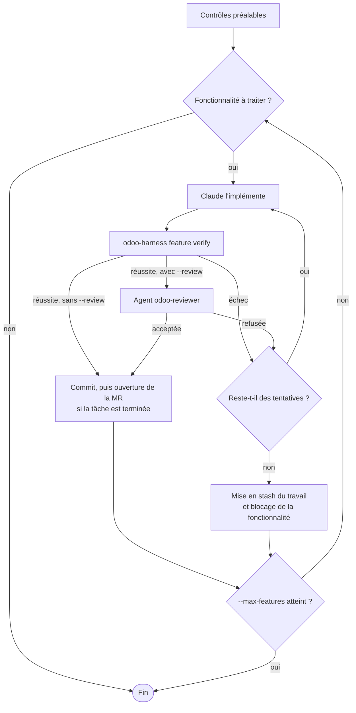

# claude-odoo-harness

Un plugin [Claude Code](https://claude.com/claude-code) pour travailler sur les projets Odoo,
de la 17.0 à la 20.0.

> 🇬🇧 [English version](README.md)

Avec le harness :

- **Claude travaille sur une seule fonctionnalité à la fois.** En démarrer une deuxième est
  refusé.
- **Une fonctionnalité n'est terminée que si elle passe la vérification** : contrôles statiques,
  tests Odoo et tests de bout en bout Playwright.
- **L'avancement est enregistré dans votre dépôt**, pour que n'importe quelle session ou
  personne de l'équipe puisse reprendre le travail.

## Sommaire

- [Prérequis](#prérequis)
- [Installation](#installation)
- [Réaliser une fonctionnalité](#réaliser-une-fonctionnalité)
- [Commandes](#commandes)
- [Fichiers ajoutés à votre dépôt](#fichiers-ajoutés-à-votre-dépôt)
- [Ce que Claude Code y gagne](#ce-que-claude-code-y-gagne)
- [Boucle autonome](#boucle-autonome)
- [Équipe](#équipe)
- [Mise à jour](#mise-à-jour)
- [Désinstallation](#désinstallation)
- [Travailler sur le harness](#travailler-sur-le-harness)

## Prérequis

- Claude Code
- Docker avec le plugin compose
- Python 3.10+
- git

## Installation

### 1. Une fois par machine : installer le plugin

Dans Claude Code, gardez le niveau utilisateur proposé par défaut :

```
/plugin marketplace add yessin-fogits/claude-odoo-harness@main
/plugin install odoo-harness@odoo-harness
```

Aucune clé SSH n'est nécessaire : le plugin est cloné en HTTPS.

### 2. Une fois par projet : mettre en place le harness

Lancez Claude Code dans l'un de ces dossiers, puis exécutez `/odoo-harness:init` :

- la racine du dépôt Odoo ;
- l'espace client, `~/Project/<client>`, avec le dépôt dans `git/` et Odoo Enterprise dans
  `enterprise/`.

Dans un dépôt Odoo sans harness, la première session le propose une fois.

`init` lit votre projet et vous demande de confirmer ce qu'il a trouvé : addons personnalisés et
tiers, Enterprise, version et image d'Odoo, branche de base, projet GitLab et fichiers de
déploiement.

Sur un projet qui contient déjà du code, il écrit aussi une carte des modules dans
`ARCHITECTURE.md` et propose les tâches ouvertes de votre Odoo comme fonctionnalités, via le
connecteur MCP Odoo.

Il enchaîne ensuite quatre étapes :

| Étape | Résultat |
|---|---|
| 1. Environnement de test | L'image du projet avec son propre PostgreSQL, son port et une base de test jetable, et tous les modules personnalisés installés. Votre stack de développement n'est pas touchée. |
| 2. Tests | Un test qui passe à chaque niveau : unitaire, intégration et e2e |
| 3. `BOOTSTRAP.md` | Comment démarrer, vérifier et réinitialiser le projet, à relire par vous |
| 4. `feature_list.json` | Le travail découpé en petites fonctionnalités, à relire par vous |

`init` propose aussi d'autoriser la commande `odoo-harness` dans vos réglages utilisateur, pour
que Claude ne demande plus la permission de l'utiliser. Pour ouvrir des merge requests, définissez
`GITLAB_TOKEN` (portée api) dans votre environnement ou dans le fichier `.env` ignoré par git. Ne
le committez jamais.

`init` committe le harness sur votre branche courante. Fusionnez ce commit dans la branche de base
avant que l'équipe démarre des branches de tâche.

## Réaliser une fonctionnalité

Vous pouvez demander tout cela à Claude, ou lancer les commandes vous-même :

```bash
# 1. Décrire le comportement et comment le vérifier
odoo-harness feature add \
  --task T2003 \
  --behavior "Le commercial applique une remise de 10 % sur une ligne de devis" \
  --verify "unit: /sale_discount" \
  --verify "e2e: e2e/test_F001_discount.py"

# 2. La démarrer : cela bascule sur la branche T2003
odoo-harness feature start F-001

# 3. Écrire le code et les tests, puis vérifier
odoo-harness feature verify F-001

# 4. Committer avec "[T2003] F-001 <comportement>", puis ouvrir la merge request
#    (possible une fois que toutes les fonctionnalités de la tâche passent)
odoo-harness gitlab mr T2003
```

Si la vérification échoue, chaque erreur indique sa cause et comment la corriger. Corrigez le
problème et relancez `feature verify`.

Pas encore de tâche Odoo ? Utilisez un nom court comme `--task` (lettres, chiffres, `-` et `_`),
et donnez-lui son vrai code plus tard :

```bash
odoo-harness feature rename-task remise-devis T2003
```

## Commandes

Lancez-les depuis le dépôt ou l'espace client.

### Fonctionnalités

| Commande | Effet |
|---|---|
| `feature status` | Affiche les fonctionnalités et leur état |
| `feature add --behavior ... --verify ... [--task T2003] [--id F-001]` | Ajoute une fonctionnalité. `--verify` peut être répété : `unit: <test-tags>`, `integration: <test-tags>` ou `e2e: <fichier>` |
| `feature start F-001 [--reopen] [--no-branch]` | Démarre une fonctionnalité et bascule sur la branche de sa tâche. Refusé si une autre fonctionnalité est en cours |
| `feature verify F-001` | Lance la vérification. C'est le seul moyen de marquer une fonctionnalité `passing` |
| `feature block F-001 --reason ...` | Marque une fonctionnalité comme bloquée |
| `feature rename-task ANCIEN NOUVEAU` | Renomme une tâche dans ses fonctionnalités, sa branche locale et `PROGRESS.md`. Les commits existants gardent l'ancien nom. Si l'ancienne branche ou merge request est sur GitLab, fermez-la vous-même |
| `feature check` | Contrôle `feature_list.json` : fichier valide, une fonctionnalité en cours au maximum, et une preuve pour chaque fonctionnalité `passing` |

### Contrôles

| Commande | Effet |
|---|---|
| `verify` | Lance les trois couches ci-dessous sur ce qui a changé sur la branche |
| `static [--all \| FICHIER...]` | Lance les contrôles statiques. `--all` liste les problèmes existants de tout le projet |
| `map [--json]` | Affiche les modules, les modèles et les dépendances |

La vérification se déroule dans cet ordre et s'arrête au premier échec :

1. **Statique** : syntaxe, XML, manifestes, contrôles du projet et pylint-odoo, sur les modules
   modifiés.
2. **Tests Odoo** : sur la base de test, pour les modules modifiés et tous les modules personnalisés
   qui en dépendent.
3. **Bout en bout** : tests Playwright, avec un log serveur propre.

Les erreurs de syntaxe, de XML, de manifeste et de CSV de sécurité bloquent toujours. Les
contrôles du projet et pylint ne bloquent que sur les lignes modifiées sur la branche.

### Environnement

| Commande | Effet |
|---|---|
| `init` | Construit l'environnement de test |
| `init --check` | Lance un contrôle de santé rapide |
| `init --reset` | Supprime la base de test et reconstruit tout |
| `compose ...` | Lance `docker compose` sur la stack du harness, par exemple `compose ps` ou `compose logs odoo` |

### Livraison

| Commande | Effet |
|---|---|
| `gitlab push T2003` | Pousse la branche de la tâche |
| `gitlab mr T2003 [--title ...]` | Pousse la branche de la tâche et ouvre sa merge request vers la branche de base (`staging` par défaut), une fois que toutes les fonctionnalités de la tâche passent |
| `guide capture T2003`, `guide build T2003` | Produit le guide utilisateur en français d'une tâche terminée, avec des captures de ses tests e2e. `/odoo-harness:guide T2003` déroule tout le processus |
| `guide check` | Liste les guides qui ne correspondent plus à leur tâche |

### Harness

| Commande | Effet |
|---|---|
| `loop run`, `loop status` | Lance la [boucle autonome](#boucle-autonome), ou affiche sa dernière exécution |
| `where` | Affiche le dépôt, le moteur et leurs versions |
| `link` | Rafraîchit la commande `~/.local/bin/odoo-harness` |

## Fichiers ajoutés à votre dépôt

| Fichier | Rôle |
|---|---|
| `CLAUDE.md` | Les règles que Claude suit sur ce projet |
| `BOOTSTRAP.md` | Comment démarrer, vérifier et réinitialiser le projet |
| `PROGRESS.md` | État actuel, travail terminé et en cours, problèmes connus, prochaines étapes |
| `DECISIONS.md` | Décisions datées du projet |
| `ARCHITECTURE.md` | Modules, modèles, dépendances, risques et dette |
| `feature_list.json` | Les fonctionnalités et leur état. Modifié uniquement par `odoo-harness feature` |
| `e2e/` | Tests Playwright |
| `harness/harness.env` | Réglages du projet : version et image d'Odoo, dossiers d'addons, base de test et port, branche de base, projet GitLab, chemins protégés, version minimale du harness |
| `harness/checks/` | Contrôles propres au projet |
| `harness/errors_project.py` | Messages « pourquoi / comment corriger » propres au projet |
| `harness/evidence/` | Un fichier de preuve par fonctionnalité `passing` |

## Ce que Claude Code y gagne

**Actions automatiques**

- **Au démarrage de la session :** charge l'état du projet et le guide de sa version d'Odoo.
- **Après chaque modification :** lance les contrôles statiques.
- **À la fin de chaque tour :** vérifie que le travail est laissé dans un état propre.
- **En permanence, bloque :**
  - les modifications de la liste des fonctionnalités, des preuves et du moteur du harness ;
  - les modifications d'Odoo core, d'Enterprise, des addons tiers et des fichiers de déploiement ;
  - les commandes qui suppriment ou ciblent une autre base que celle de test ;
  - les commandes qui suppriment des volumes Docker ou contournent les hooks git ;
  - les push vers `main`, `master`, `production` et la branche de base.

**Skills**

| Skill | Usage |
|---|---|
| `/odoo-harness:init` | Mettre en place le harness dans un projet |
| `/odoo-harness:update` | Rafraîchir les fichiers du harness dans le projet |
| `/odoo-harness:guide T2003` | Écrire le guide utilisateur d'une tâche terminée |
| `/odoo-harness:add-harness-check` | Transformer une erreur trouvée en revue en contrôle automatique |
| `odoo` | Référence Odoo pour chaque version : ORM, vues, sécurité, OWL, contrôleurs, tests, migrations. Claude l'utilise de lui-même |

**Agents**

| Agent | Usage |
|---|---|
| `odoo-reviewer` | Relit la fonctionnalité en cours et propose de nouveaux contrôles |
| `odoo-explorer` | Trouve les définitions parentes dans le source Odoo de votre version |

## Boucle autonome

`odoo-harness loop run` laisse des sessions Claude Code sans interface traiter
`feature_list.json`.



**Avant de commencer**

- L'arbre de travail doit être propre.
- `odoo-harness init --check` doit réussir.
- La CLI `claude` doit être connectée, avec le plugin installé.

**Bon à savoir**

- La boucle prend la fonctionnalité en cours, sinon la première non démarrée.
- Quand une fonctionnalité termine sa tâche, la boucle pousse la branche et ouvre la merge
  request. Utilisez `--no-mr` pour désactiver ce comportement.
- Le travail en échec est conservé dans un `git stash` nommé. Le nom et la raison sont dans
  `PROGRESS.md`.

| Option | Effet | Défaut |
|---|---|---|
| `--max-features N` | Fonctionnalités à terminer dans cette exécution | 1 |
| `--attempts N` | Tentatives par fonctionnalité | 3 |
| `--review` | Exige aussi un Accept de l'agent `odoo-reviewer` | désactivé |
| `--branch NOM` | Crée d'abord cette branche et travaille dessus | aucune |
| `--no-mr` | Ne pousse pas et n'ouvre pas de merge request | désactivé |
| `--max-turns N` | Limite de tours par appel d'agent | 80 |
| `--max-budget-usd N` | Limite en dollars par appel d'agent | aucune |
| `--timeout N` | Limite de temps par appel d'agent, en secondes | 3600 |

Les logs sont dans `.harness/loop/<exécution>/`.

## Équipe

Chaque personne installe le plugin une fois, comme à l'étape 1 de l'[installation](#installation).
Claude Code le propose aussi quand vous ouvrez un dépôt qui utilise le harness. Un clone neuf n'a
besoin de rien d'autre.

Si le plugin est plus ancien que le `HARNESS_VERSION` du projet, `odoo-harness` refuse de
s'exécuter et vous demande de le mettre à jour.

## Mise à jour

**Le plugin** se met à jour automatiquement. Claude Code vous demande ensuite de lancer
`/reload-plugins`. Pour mettre à jour tout de suite :

```bash
claude plugin update odoo-harness@odoo-harness
```

Pour désactiver les mises à jour automatiques, allez dans `/plugin` → **Marketplaces** →
`odoo-harness` → **Disable auto-update**.

**Les fichiers du harness d'un projet** : lancez `/odoo-harness:update` dans le projet, puis
committez le résultat. Il rafraîchit le bloc de `CLAUDE.md`, les réglages et la version minimale,
et conserve votre état et votre configuration.

**Un projet installé avant la 2.0**, avec une copie du moteur dans `harness/` :

1. Installez `odoo-harness`. L'ancien plugin `odoo-harness-<N>` continue de piloter le projet
   jusqu'à l'étape suivante.
2. Lancez `/odoo-harness:update` dans le projet.
3. Une fois tous vos projets migrés, supprimez l'ancien plugin :

```bash
claude plugin uninstall odoo-harness-<N>@odoo-harness
```

**Une nouvelle version d'Odoo** est une migration. Changez `ODOO_VERSION` et `ODOO_IMAGE` dans
`harness/harness.env`, puis suivez `references/migrations.md` dans le guide de la nouvelle version,
dans le skill `odoo`.

## Désinstallation

**Le désactiver pour vous dans un projet :**

```bash
claude plugin disable odoo-harness@odoo-harness --scope local
```

**Retirer le plugin de votre machine.** Cela ne change pas vos dépôts Odoo.

```bash
claude plugin uninstall odoo-harness@odoo-harness
```

Supprimez ensuite `~/.odoo-harness/` et `~/.local/bin/odoo-harness`. Pour retirer aussi la
marketplace et tous les plugins installés depuis elle :

```bash
claude plugin marketplace remove odoo-harness
```

**Retirer le harness d'un dépôt.** Faites-le avant de désinstaller le plugin :

1. Arrêtez les conteneurs avec `odoo-harness compose down`. Ajoutez `-v` seulement si vous voulez
   aussi supprimer les volumes de la base de test.
2. Dans `CLAUDE.md`, supprimez le bloc entre `<!-- odoo-harness:start -->` et
   `<!-- odoo-harness:end -->`.
3. Dans `.claude/settings.json`, retirez `odoo-harness@odoo-harness` de `enabledPlugins`,
   `odoo-harness` de `extraKnownMarketplaces`, et les permissions du harness dont vous ne voulez
   plus.
4. Supprimez `harness/` et `.harness/`, ainsi que `e2e/`, `.pylintrc` et
   `.pre-commit-config.yaml` si vous ne les gardez pas.
5. Gardez ou archivez `PROGRESS.md`, `DECISIONS.md`, `feature_list.json` et `BOOTSTRAP.md`, qui
   contiennent l'historique du projet.

## Travailler sur le harness

Lancez les tests :

```bash
pip install pytest shellcheck-py "pylint-odoo==10.0.12"
```

```bash
python -m pytest -q
```

- **Ajouter une version d'Odoo :** ajoutez-la à `versions.json`, écrivez son guide dans
  `skills/odoo/versions/<version>/` à l'aide de `tools/odoo-skill-extract/`, et ajoutez-la à la
  matrice CI dans `.github/workflows/ci.yml`.
- **Modifier le moteur :** augmentez `engine/VERSION` dès qu'un changement peut modifier un verdict
  ou une commande.

Conception et décisions : [docs/ARCHITECTURE.md](docs/ARCHITECTURE.md) et
[DECISIONS.md](DECISIONS.md). Le harness s'appuie sur
[Learn Harness Engineering](https://walkinglabs.github.io/learn-harness-engineering/fr/).
