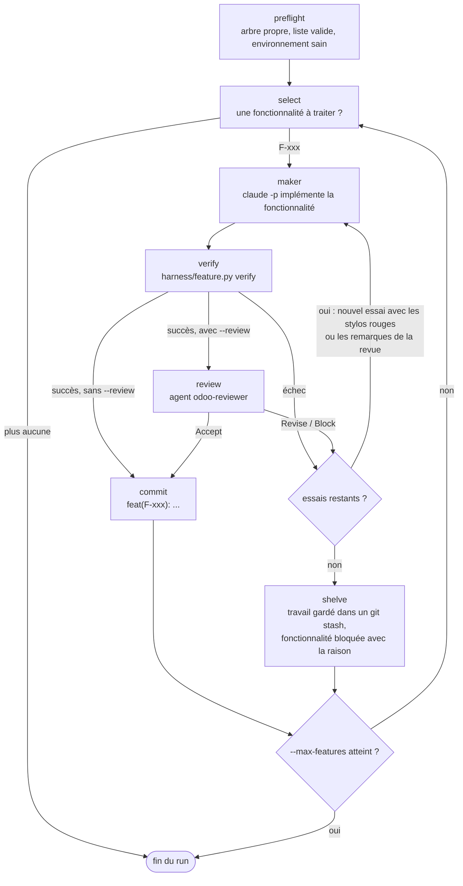

# claude-odoo-harness

Un harness [Claude Code](https://claude.com/claude-code) pour les projets Odoo, basé sur
[Learn Harness Engineering](https://walkinglabs.github.io/learn-harness-engineering/fr/).

Le harness est le système de travail autour du modèle. Il rend l'agent fiable sur un projet
Odoo complet, nouveau ou déjà développé (modules spécifiques, modules OCA, Odoo Enterprise,
Docker, GitLab) :
- **L'état vit dans le dépôt** : `PROGRESS.md`, `DECISIONS.md` et `feature_list.json`.
- **WIP = 1** : une fonctionnalité à la fois. La suivante ne commence qu'après la vérification e2e.
- **Le harness contrôle les états** : l'agent ne peut pas passer lui-même son travail en `passing`.
- **Trois couches de vérification** : analyse statique (pylint-odoo), tests Odoo, puis e2e Playwright.
- **Annotations au stylo rouge** : chaque échec dit ce qui a échoué, POURQUOI et COMMENT corriger.
- **Sessions automatiques** : des hooks chargent le contexte au début et vérifient l'état propre à la fin.
- **Tâches Odoo → fonctionnalités → merge request** : chaque tâche Odoo (`T2003`) est découpée en
  fonctionnalités, traitée sur sa propre branche, et livrée en merge request quand toutes ses
  fonctionnalités passent.

> 🇬🇧 [English version](README.md)

## Branches = versions d'Odoo
| Branche | Odoo |
|---|---|
| `17.0` | 17.0 |
| `18.0` | 18.0 |
| `19.0` | 19.0 |
| `20.0` | 20.0 |

## Le skill Odoo

Chaque branche fournit `skills/odoo/` pour sa version d'Odoo : ORM, vues, sécurité, OWL,
contrôleurs, tests, migrations, et les changements depuis les versions précédentes. Il est
écrit à partir du vrai code source `odoo/odoo`, et la CI le vérifie contre ce code :

```
tools/odoo-skill-extract/fetch_odoo.sh 20.0 /tmp/odoo-20.0
python3 tools/odoo-skill-extract/extract.py /tmp/odoo-20.0 -o /tmp/facts.json
python3 tools/odoo-skill-extract/check_skill.py /tmp/facts.json skills/odoo
```

## Installer dans un projet Odoo
1. Ajouter la marketplace (`/plugin marketplace add yessin-fogits/claude-odoo-harness@main`) et installer `odoo-harness-<N>@odoo-harness` pour votre version d'Odoo.
2. Lancer Claude Code dans le dossier du client (organisation fogits : `~/Project/<client>`,
   avec le dépôt git dans `git/` et Odoo Enterprise dans `enterprise/`), ou dans le dépôt
   lui-même, puis `/odoo-harness-<N>:init`. Le harness est installé dans le dépôt (`git/`) et
   versionné avec lui ; le dossier du client reçoit un `CLAUDE.md` qui importe
   `git/CLAUDE.md` et un `.claude/settings.json` qui active le plugin (non versionnés). Après
   le clone d'un projet qui a déjà le harness, `/odoo-harness-<N>:update` écrit seulement ces
   deux fichiers. La commande :
   - **détecte le projet** : `addons_path` de `odoo-stag.conf` / `odoo-main.conf`, modules
     spécifiques (`extra-addons/<client>`), modules tiers (`extra-addons/oca`, en lecture
     seule), Enterprise, la version et l'image d'Odoo depuis le `Dockerfile`, la branche de
     base (`staging`), le projet GitLab et les fichiers de déploiement (en lecture seule).
     Vous confirmez ;
   - **découvre un projet existant** : écrit `ARCHITECTURE.md` (carte des modules produite par
     `harness/project_map.py`, dépendances, risques et dette relevés par
     `harness/static_checks.py --all`) et une section `# This project` dans `CLAUDE.md`, lit les
     tâches ouvertes du projet correspondant dans votre Odoo via le connecteur MCP Odoo (en
     lecture seule) et les propose comme fonctionnalités ;
   - suit les 4 étapes d'initialisation : environnement exécutable (l'image du projet, sa
     propre base avec données de démo et son propre port, jamais votre stack de dev), cadre
     de test vérifiable, contrat d'amorçage (`BOOTSTRAP.md`), découpage des tâches
     (`feature_list.json`).

Aucune clé SSH n'est nécessaire : les plugins sont clonés en HTTPS. Si une installation échoue
avec `Permission denied (publickey)`, lancez `/plugin marketplace update odoo-harness` et réinstallez.

## Ce que le harness vérifie, et ce qu'il ne touche pas
- Il teste les modules modifiés par une branche **et tous les modules spécifiques qui en
  dépendent** ; toute la suite e2e tourne quand plus d'un module change.
- Les problèmes déjà présents ne bloquent pas une fonctionnalité : le lint et les
  vérifications du projet ne bloquent que sur les lignes modifiées par la branche.
  `harness/static_checks.py --all` liste le reste comme dette. Les erreurs bloquantes
  (syntaxe, XML, manifeste) bloquent toujours.
- pylint-odoo tourne avec le `.pylintrc-mandatory` du projet, à la version d'Odoo du projet.
- Jamais modifiés par l'agent : le cœur d'Odoo et Enterprise, les modules tiers, les fichiers
  de déploiement (Dockerfile, fichiers compose, `odoo-*.conf`, `.gitlab-ci.yml`), les bases
  autres que la base de test, `staging` et `main` (pas de push direct), et les secrets
  (vérification `no-hardcoded-secrets`).

## Tâches Odoo et merge requests
```
harness/feature.py add --task T2003 --behavior "..." --verify "unit: ..." --verify "e2e: ..."
harness/feature.py start F-001      # bascule sur la branche T2003 (créée depuis staging)
harness/feature.py verify F-001     # passing + preuves ; commit "[T2003] F-001 ..."
harness/gitlab.py mr T2003          # quand toutes les fonctionnalités de T2003 passent : push + merge request
```
La merge request vise `staging` et liste les fonctionnalités avec leurs preuves. Elle demande
un jeton GitLab avec le scope `api` dans `GITLAB_TOKEN` (environnement, ou fichier `.env` du
dépôt, ignoré par git) ; ne le committez jamais. La boucle autonome l'ouvre d'elle-même quand
elle termine une tâche (`--no-mr` pour le désactiver).

## Boucle autonome

`harness/loop.py run` avance seul dans `feature_list.json`, avec Claude Code sans
interface, sous forme de graphe producteur-vérificateur :



Chaque étape :

1. **preflight** : l'arbre de travail est propre, `feature.py check` passe et l'environnement est sain.
2. **select** : la fonctionnalité en cours, sinon la première `not_started`.
3. **maker** : une session Claude Code sans interface (`claude -p`) implémente la fonctionnalité.
4. **verify** : `harness/feature.py verify` lance les 3 couches ; c'est le seul juge du « fini ».
5. **review** (avec `--review`) : l'agent `odoo-reviewer`, dans un contexte neuf, doit répondre Accept.
6. **commit** du travail vérifié, ou **shelve** quand les essais sont épuisés.

- Le producteur ne juge jamais son propre travail : seul `feature.py verify` peut passer une
  fonctionnalité en `passing`, et `--review` ajoute l'agent `odoo-reviewer` comme second
  vérificateur indépendant.
- Seul le travail vérifié est commité. Le travail en échec est gardé dans un `git stash`
  nommé et la fonctionnalité est bloquée avec la raison et le nom du stash dans PROGRESS.md.
- Budgets : `--max-features` (1 par défaut, pour qu'un humain relise chaque fonctionnalité),
  `--attempts` (3 par défaut), `--max-turns` et `--max-budget-usd` par appel d'agent, `--timeout`.
- `--branch loop/<nom>` travaille sur une nouvelle branche. Journaux et sorties des agents :
  `.harness/loop/<run>/` ; dernier résumé : `harness/loop.py status`.
- Prérequis : un arbre de travail propre, une base saine (`harness/init.sh --check`), et la
  commande `claude` connectée avec le plugin installé.

## Collaborateurs

Dans les commandes ci-dessous, `<N>` est la version majeure d'Odoo (17, 18, 19 ou 20).


Le skill init active le plugin dans le `.claude/settings.json` du projet, mais Claude Code
ne télécharge pas un plugin à partir des seuls réglages du projet. Chaque personne
l'installe une fois :

```
claude plugin install odoo-harness-<N>@odoo-harness --scope project
```

## Mise à jour

**Le plugin** (skills, agents, hooks). Les projets installés par le skill init activent la
mise à jour automatique de la marketplace `odoo-harness` : Claude Code met le plugin à jour
en arrière-plan et vous demande de lancer `/reload-plugins`. Pour mettre à jour tout de suite :

```
claude plugin update odoo-harness-<N>@odoo-harness
```

ou `/plugin` → **Installed** → `odoo-harness-<N>` → **Update now**. Pour arrêter les mises
à jour automatiques : `/plugin` → **Marketplaces** → `odoo-harness` → **Disable auto-update**.

**Les fichiers du harness dans votre dépôt Odoo** (scripts du harness, vérifications,
catalogue stylo rouge, bloc CLAUDE.md). Après une mise à jour du plugin, lancez
`/odoo-harness-<N>:update`. Il remplace les fichiers du harness, conserve l'état du projet
(PROGRESS.md, DECISIONS.md, feature_list.json, BOOTSTRAP.md, ARCHITECTURE.md) et sa
configuration (harness/harness.env, e2e/conftest.py, harness/errors_project.py), régénère
`harness/docker-compose.yml` et `harness/odoo.conf` depuis `harness/harness.env`, montre
comment les modèles des fichiers conservés ont changé, lance les vérifications et enregistre
la mise à jour. Committez le résultat. Un harness installé avant le mode projet complet
(`MODULES`, `ADDONS_DIR`) est migré par la même commande.

**Une autre version d'Odoo.** Passer un projet à la version suivante d'Odoo est une
migration, pas une mise à jour : installez le plugin de la nouvelle version, changez
`ODOO_VERSION` et `ODOO_IMAGE` dans `harness/harness.env` et le plugin activé dans
`.claude/settings.json`, puis suivez `references/migrations.md` du nouveau skill `odoo`.

## Désinstallation

- Le désactiver pour vous dans un projet : `claude plugin disable odoo-harness-<N>@odoo-harness --scope local`
- Désinstaller le plugin : `claude plugin uninstall odoo-harness-<N>@odoo-harness`
  (`--scope project` le retire du `.claude/settings.json` du projet pour tout le monde)
- Retirer la marketplace et tous les plugins installés depuis elle : `claude plugin marketplace remove odoo-harness`

Désinstaller le plugin ne modifie pas votre dépôt Odoo. Pour en retirer le harness :

1. Supprimez le bloc entre `<!-- odoo-harness:start -->` et `<!-- odoo-harness:end -->` dans `CLAUDE.md`.
2. Dans `.claude/settings.json`, retirez `odoo-harness-<N>@odoo-harness` de `enabledPlugins`,
   `odoo-harness` de `extraKnownMarketplaces`, et les règles de permission du harness dont vous ne voulez plus.
3. Arrêtez les conteneurs du harness :
   `docker compose --project-directory . -f harness/docker-compose.yml --env-file harness/harness.env down`
   (ajoutez `-v` seulement pour supprimer les volumes de la base de test).
4. Supprimez `harness/`, `.harness/`, et les fichiers ajoutés par le harness que vous ne gardez
   pas : `e2e/`, et `.pylintrc` / `.pre-commit-config.yaml` si c'est le harness qui les a créés.
5. Gardez ou archivez `PROGRESS.md`, `DECISIONS.md`, `feature_list.json`, `BOOTSTRAP.md` et
   `ARCHITECTURE.md` : c'est l'historique et la carte du projet.

## État
Les phases 1 à 7 sont en place : harness de base, machine à états et vérification en 3 couches, hooks de session automatiques, le skill Odoo par version, la boucle revue → vérification, la boucle autonome, et le mode projet complet (détection, découverte, tâches Odoo, merge requests). Voir [docs/ARCHITECTURE.md](docs/ARCHITECTURE.md) pour le plan
complet et [PROGRESS.md](PROGRESS.md) pour l'état actuel.
