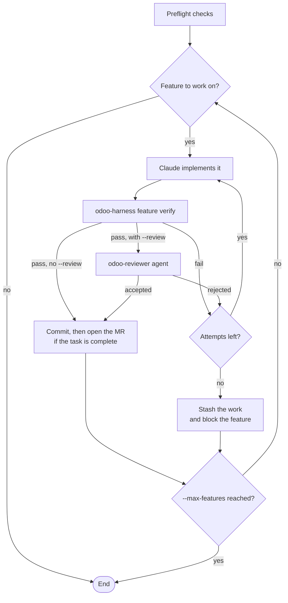

# claude-odoo-harness

A [Claude Code](https://claude.com/claude-code) plugin for working on Odoo projects, from 17.0
to 20.0.

> 🇫🇷 [Version française](README.fr.md)

With the harness:

- **Claude works on one feature at a time.** Starting a second one is refused.
- **A feature is done only when it passes verification**: static checks, Odoo tests and
  Playwright end-to-end tests.
- **Progress is saved in your repository**, so any session or teammate can pick up the work.

## Contents

- [Requirements](#requirements)
- [Install](#install)
- [Build a feature](#build-a-feature)
- [Commands](#commands)
- [Files added to your repository](#files-added-to-your-repository)
- [What Claude Code gains](#what-claude-code-gains)
- [Autonomous loop](#autonomous-loop)
- [Teammates](#teammates)
- [Update](#update)
- [Uninstall](#uninstall)
- [Work on the harness](#work-on-the-harness)

## Requirements

- Claude Code
- Docker with the compose plugin
- Python 3.10+
- git

## Install

### 1. Once per machine: install the plugin

In Claude Code, keep the default user scope:

```
/plugin marketplace add yessin-fogits/claude-odoo-harness@main
/plugin install odoo-harness@odoo-harness
```

No SSH key is needed: the plugin is cloned over HTTPS.

### 2. Once per project: set up the harness

Start Claude Code in one of these folders, then run `/odoo-harness:init`:

- the root of the Odoo repository;
- the client workspace, `~/Project/<client>`, with the repository in `git/` and Odoo Enterprise
  in `enterprise/`.

In an Odoo repository without the harness, the first session offers this once.

`init` reads your project and asks you to confirm what it found: custom and third-party
addons, Enterprise, Odoo version and image, base branch, GitLab project and deployment files.

On a project that already has code, it also writes a map of the modules in `ARCHITECTURE.md`
and proposes the open tasks from your Odoo as features, through the Odoo MCP connector.

It then goes through four steps:

| Step | Result |
|---|---|
| 1. Test environment | The project's image with its own PostgreSQL, port and disposable test database, and every custom module installed. Your dev stack is not touched. |
| 2. Tests | One passing test at each level: unit, integration and e2e |
| 3. `BOOTSTRAP.md` | How to start, verify and reset the project, for you to review |
| 4. `feature_list.json` | The work split into small features, for you to review |

`init` also offers to allow the `odoo-harness` command in your user settings, so Claude stops
asking permission for it. To open merge requests, set `GITLAB_TOKEN` (api scope) in your
environment or in the git-ignored `.env` file. Never commit it.

`init` commits the harness on your current branch. Merge that commit into the base branch before
teammates start task branches.

## Build a feature

You can ask Claude to do all of this, or run the commands yourself:

```bash
# 1. Describe the behavior and how to check it
odoo-harness feature add \
  --task T2003 \
  --behavior "Salesperson applies a 10% discount on a quotation line" \
  --verify "unit: /sale_discount" \
  --verify "e2e: e2e/test_F001_discount.py"

# 2. Start it: this checks out the T2003 branch
odoo-harness feature start F-001

# 3. Write the code and the tests, then verify
odoo-harness feature verify F-001

# 4. Commit as "[T2003] F-001 <behavior>", then open the merge request
#    (this works once every feature of the task passes)
odoo-harness gitlab mr T2003
```

If verification fails, each error says why it happened and how to fix it. Fix the problem and
run `feature verify` again.

No Odoo task yet? Use a short name as `--task` (letters, digits, `-` and `_`), and give it the
real code later:

```bash
odoo-harness feature rename-task remise-devis T2003
```

## Commands

Run them from the repository or the client workspace.

### Features

| Command | What it does |
|---|---|
| `feature status` | Shows the features and their state |
| `feature add --behavior ... --verify ... [--task T2003] [--id F-001]` | Adds a feature. `--verify` is repeatable: `unit: <test-tags>`, `integration: <test-tags>` or `e2e: <file>` |
| `feature start F-001 [--reopen] [--no-branch]` | Starts a feature and checks out its task branch. Refused if another feature is in progress |
| `feature verify F-001` | Runs the verification. This is the only way to mark a feature `passing` |
| `feature block F-001 --reason ...` | Marks a feature as blocked |
| `feature rename-task OLD NEW` | Renames a task in its features, its local branch and `PROGRESS.md`. Existing commits keep the old name. If the old branch or merge request is on GitLab, close it yourself |
| `feature check` | Checks `feature_list.json`: a valid file, one feature in progress at most, and evidence for each passing feature |

### Checks

| Command | What it does |
|---|---|
| `verify` | Runs the three layers below on what changed on the branch |
| `static [--all \| FILE...]` | Runs the static checks. `--all` lists the existing problems across the project |
| `map [--json]` | Shows the modules, models and dependencies |

Verification runs in this order and stops at the first failure:

1. **Static**: syntax, XML, manifests, project checks and pylint-odoo, on the changed modules.
2. **Odoo tests**: on the test database, for the changed modules and every custom module that
   depends on them.
3. **End-to-end**: Playwright tests, with a clean server log.

Syntax, XML, manifest and security CSV errors always block. Project checks and pylint block
only on lines changed on the branch.

### Environment

| Command | What it does |
|---|---|
| `init` | Builds the test environment |
| `init --check` | Runs a quick health check |
| `init --reset` | Drops the test database and rebuilds from scratch |
| `compose ...` | Runs `docker compose` on the harness stack, such as `compose ps` or `compose logs odoo` |

### Delivery

| Command | What it does |
|---|---|
| `gitlab push T2003` | Pushes the task branch |
| `gitlab mr T2003 [--title ...]` | Pushes the task branch and opens its merge request to the base branch (`staging` by default), once every feature of the task passes |
| `guide capture T2003`, `guide build T2003` | Produces the French user guide of a completed task, with screenshots from its e2e tests. `/odoo-harness:guide T2003` runs the whole process |
| `guide check` | Lists the guides that no longer match their task |

### Harness

| Command | What it does |
|---|---|
| `loop run`, `loop status` | Runs the [autonomous loop](#autonomous-loop), or shows its last run |
| `where` | Shows the repository, the engine and their versions |
| `link` | Refreshes the `~/.local/bin/odoo-harness` command |

## Files added to your repository

| File | Purpose |
|---|---|
| `CLAUDE.md` | The rules Claude follows on this project |
| `BOOTSTRAP.md` | How to start, verify and reset the project |
| `PROGRESS.md` | Current state, finished and ongoing work, known issues, next steps |
| `DECISIONS.md` | Dated decisions of the project |
| `ARCHITECTURE.md` | Modules, models, dependencies, risks and debt |
| `feature_list.json` | The features and their state. Changed only by `odoo-harness feature` |
| `e2e/` | Playwright tests |
| `harness/harness.env` | Project settings: Odoo version and image, addon folders, test database and port, base branch, GitLab project, protected paths, minimum harness version |
| `harness/checks/` | Checks specific to the project |
| `harness/errors_project.py` | Project-specific "why / how to fix" messages |
| `harness/evidence/` | One proof file per passing feature |

## What Claude Code gains

**Automatic actions**

- **At session start:** loads the project state and the guide for its Odoo version.
- **After each edit:** runs the static checks.
- **At the end of each turn:** checks that the work is left in a clean state.
- **At all times, blocks:**
  - edits to the feature list, the evidence and the harness engine;
  - edits to Odoo core, Enterprise, third-party addons and deployment files;
  - commands that drop or target a database other than the test one;
  - commands that delete Docker volumes or skip git hooks;
  - pushes to `main`, `master`, `production` and the base branch.

**Skills**

| Skill | Use |
|---|---|
| `/odoo-harness:init` | Set up the harness in a project |
| `/odoo-harness:update` | Refresh the project's harness files |
| `/odoo-harness:guide T2003` | Write the user guide of a completed task |
| `/odoo-harness:add-harness-check` | Turn a mistake found in review into an automatic check |
| `odoo` | Odoo reference for each version: ORM, views, security, OWL, controllers, tests, migrations. Claude uses it on its own |

**Agents**

| Agent | Use |
|---|---|
| `odoo-reviewer` | Reviews the current feature and proposes new checks |
| `odoo-explorer` | Finds parent definitions in the Odoo source of your version |

## Autonomous loop

`odoo-harness loop run` lets headless Claude Code sessions work through `feature_list.json`.



**Before you start**

- The working tree must be clean.
- `odoo-harness init --check` must pass.
- The `claude` CLI must be logged in, with the plugin installed.

**Good to know**

- The loop picks the feature in progress, otherwise the first one not started.
- When a feature completes its task, the loop pushes the branch and opens the merge request.
  Use `--no-mr` to turn this off.
- Failed work is kept in a named `git stash`. The name and the reason are in `PROGRESS.md`.

| Option | Effect | Default |
|---|---|---|
| `--max-features N` | Features to finish in this run | 1 |
| `--attempts N` | Attempts per feature | 3 |
| `--review` | Also requires an Accept from the `odoo-reviewer` agent | off |
| `--branch NAME` | Creates this branch first and works on it | none |
| `--no-mr` | Does not push or open a merge request | off |
| `--max-turns N` | Turn limit per agent call | 80 |
| `--max-budget-usd N` | Dollar limit per agent call | none |
| `--timeout N` | Time limit per agent call, in seconds | 3600 |

Logs are in `.harness/loop/<run>/`.

## Teammates

Each person installs the plugin once, as in [Install](#install), step 1. Claude Code also offers
it when you open a repository that uses the harness. A fresh clone needs nothing else.

If the plugin is older than the project's `HARNESS_VERSION`, `odoo-harness` refuses to run and
asks you to update it.

## Update

**The plugin** updates automatically. Claude Code then asks you to run `/reload-plugins`. To
update right away:

```bash
claude plugin update odoo-harness@odoo-harness
```

To turn off automatic updates, go to `/plugin` → **Marketplaces** → `odoo-harness` →
**Disable auto-update**.

**A project's harness files**: run `/odoo-harness:update` in the project, then commit the
result. It refreshes the `CLAUDE.md` block, the settings and the minimum version, and keeps
your state and configuration.

**A project installed before 2.0**, with a copy of the engine in `harness/`:

1. Install `odoo-harness`. The old `odoo-harness-<N>` plugin keeps driving the project until the
   next step.
2. Run `/odoo-harness:update` in the project.
3. Once all your projects are migrated, remove the old plugin:

```bash
claude plugin uninstall odoo-harness-<N>@odoo-harness
```

**A new Odoo version** is a migration. Change `ODOO_VERSION` and `ODOO_IMAGE` in
`harness/harness.env`, then follow `references/migrations.md` in the new version's guide, in
the `odoo` skill.

## Uninstall

**Turn it off for yourself in one project:**

```bash
claude plugin disable odoo-harness@odoo-harness --scope local
```

**Remove the plugin from your machine.** This does not change your Odoo repositories.

```bash
claude plugin uninstall odoo-harness@odoo-harness
```

Then delete `~/.odoo-harness/` and `~/.local/bin/odoo-harness`. To also remove the marketplace
and every plugin installed from it:

```bash
claude plugin marketplace remove odoo-harness
```

**Remove the harness from a repository.** Do this before uninstalling the plugin:

1. Stop the containers with `odoo-harness compose down`. Add `-v` only if you also want to
   delete the test database volumes.
2. In `CLAUDE.md`, delete the block between `<!-- odoo-harness:start -->` and
   `<!-- odoo-harness:end -->`.
3. In `.claude/settings.json`, remove `odoo-harness@odoo-harness` from `enabledPlugins`,
   `odoo-harness` from `extraKnownMarketplaces`, and any harness permissions you no longer want.
4. Delete `harness/` and `.harness/`, plus `e2e/`, `.pylintrc` and `.pre-commit-config.yaml` if
   you don't keep them.
5. Keep or archive `PROGRESS.md`, `DECISIONS.md`, `feature_list.json` and `BOOTSTRAP.md`, which
   hold the project's history.

## Work on the harness

Run the tests:

```bash
pip install pytest shellcheck-py "pylint-odoo==10.0.12"
```

```bash
python -m pytest -q
```

- **Add an Odoo version:** add it to `versions.json`, write its guide in
  `skills/odoo/versions/<version>/` with the help of `tools/odoo-skill-extract/`, and add it to
  the CI matrix in `.github/workflows/ci.yml`.
- **Change the engine:** bump `engine/VERSION` whenever a change can alter a verdict or a
  command.

Design and decisions: [docs/ARCHITECTURE.md](docs/ARCHITECTURE.md) and
[DECISIONS.md](DECISIONS.md). The harness is based on
[Learn Harness Engineering](https://walkinglabs.github.io/learn-harness-engineering/fr/).
