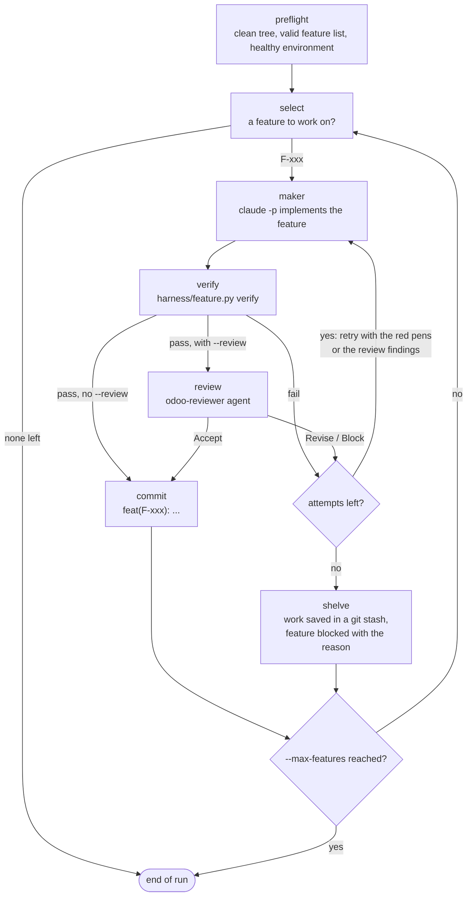

# claude-odoo-harness

A [Claude Code](https://claude.com/claude-code) harness for Odoo projects, based on
[Learn Harness Engineering](https://walkinglabs.github.io/learn-harness-engineering/fr/).

A harness is the work system around the model. It makes an agent reliable on long Odoo projects:
- **State lives in the repo**: `PROGRESS.md`, `DECISIONS.md` and `feature_list.json`.
- **WIP = 1**: one feature at a time. The next one starts only after e2e verification passes.
- **The harness owns feature states**: the agent cannot mark its own work `passing`.
- **Three verification layers**: static analysis (pylint-odoo), Odoo tests, then Playwright e2e.
- **Red-pen errors**: every failure says what failed, WHY and HOW TO FIX it.
- **Automatic sessions**: hooks load the context at start and check for a clean state at stop.

> 🇫🇷 [Version française](README.fr.md)

## Branches = Odoo versions
| Branch | Odoo |
|---|---|
| `17.0` | 17.0 |
| `18.0` | 18.0 |
| `19.0` | 19.0 |
| `20.0` | 20.0 |

## The Odoo skill

Each branch ships `skills/odoo/` for its Odoo version: ORM, views, security, OWL,
controllers, tests, migrations, and the changes since the previous versions. It is written
from the real `odoo/odoo` source and CI checks it against that source:

```
tools/odoo-skill-extract/fetch_odoo.sh 20.0 /tmp/odoo-20.0
python3 tools/odoo-skill-extract/extract.py /tmp/odoo-20.0 -o /tmp/facts.json
python3 tools/odoo-skill-extract/check_skill.py /tmp/facts.json skills/odoo
```

## Install in an Odoo project
1. Add the marketplace (`/plugin marketplace add yessin-fogits/claude-odoo-harness@main`) and install `odoo-harness-<N>@odoo-harness` for your Odoo version.
2. In your Odoo repository, run `/odoo-harness-<N>:init`. It goes through the 4 initialization steps:
   1. executable environment (Docker Compose, test DB, modules installed);
   2. verifiable test frame (a passing test at each level);
   3. bootstrap contract (`BOOTSTRAP.md`);
   4. task breakdown (`feature_list.json`).

## Autonomous loop

`harness/loop.py run` works through `feature_list.json` on its own, with Claude Code
headless, as a maker-checker graph:



Each step:

1. **preflight**: the working tree is clean, `feature.py check` passes and the environment is healthy.
2. **select**: the feature in progress, else the first `not_started` one.
3. **maker**: a headless Claude Code session (`claude -p`) implements the feature.
4. **verify**: `harness/feature.py verify` runs the 3 layers; it is the only judge of done.
5. **review** (with `--review`): the `odoo-reviewer` agent, in a fresh context, must answer Accept.
6. **commit** the verified work, or **shelve** it once the attempts are used up.

- The maker never judges its own work: only `feature.py verify` can mark a feature
  passing, and `--review` adds the `odoo-reviewer` agent as a second, independent checker.
- Only verified work is committed. Failed work is kept in a named `git stash` and the
  feature is blocked with the reason and the stash name in PROGRESS.md.
- Budgets: `--max-features` (default 1, so a human reviews each feature), `--attempts`
  (default 3), `--max-turns` and `--max-budget-usd` per agent call, `--timeout`.
- `--branch loop/<name>` works on a new branch. Logs and agent outputs:
  `.harness/loop/<run>/`; last summary: `harness/loop.py status`.
- Requirements: a clean working tree, a healthy baseline (`harness/init.sh --check`), and
  the `claude` CLI logged in with the plugin installed.

## Collaborators

In the commands below, `<N>` is your Odoo major version (17, 18, 19 or 20).


The init skill enables the plugin in the project's `.claude/settings.json`, but Claude Code
does not download a plugin from project settings alone. Each person installs it once:

```
claude plugin install odoo-harness-<N>@odoo-harness --scope project
```

## Update

**The plugin** (skills, agents, hooks). Projects installed by the init skill turn on
auto-update for the `odoo-harness` marketplace: Claude Code updates the plugin in the
background and asks you to run `/reload-plugins`. To update now:

```
claude plugin update odoo-harness-<N>@odoo-harness
```

or `/plugin` → **Installed** → `odoo-harness-<N>` → **Update now**. To stop automatic
updates: `/plugin` → **Marketplaces** → `odoo-harness` → **Disable auto-update**.

**The harness files in your Odoo repository** (harness scripts, checks, red-pen catalog,
CLAUDE.md block). After a plugin update, run `/odoo-harness-<N>:update`. It replaces the
harness files, keeps the project state (PROGRESS.md, DECISIONS.md, feature_list.json,
BOOTSTRAP.md) and configuration (docker-compose.yml, odoo.conf, harness/harness.env,
e2e/conftest.py, harness/errors_project.py), shows how the templates of the kept files
changed, runs the checks, and records the update. Commit the result.

**Another Odoo version.** Moving a project from one Odoo version to the next is a
migration, not an update: install the plugin of the new version, change `ODOO_VERSION`
and `ODOO_IMAGE` in `harness/harness.env` and the enabled plugin in
`.claude/settings.json`, then follow `references/migrations.md` of the new `odoo` skill.

## Uninstall

- Turn it off for yourself in one project: `claude plugin disable odoo-harness-<N>@odoo-harness --scope local`
- Uninstall the plugin: `claude plugin uninstall odoo-harness-<N>@odoo-harness`
  (`--scope project` removes it from the project's `.claude/settings.json` for everyone)
- Remove the marketplace and every plugin installed from it: `claude plugin marketplace remove odoo-harness`

Uninstalling the plugin does not touch your Odoo repository. To remove the harness from it:

1. Delete the block between `<!-- odoo-harness:start -->` and `<!-- odoo-harness:end -->` in `CLAUDE.md`.
2. In `.claude/settings.json`, remove `odoo-harness-<N>@odoo-harness` from `enabledPlugins`,
   `odoo-harness` from `extraKnownMarketplaces`, and the harness permission rules you no longer want.
3. Stop the containers: `docker compose --env-file harness/harness.env down`
   (add `-v` only to delete the test database volumes).
4. Delete `harness/`, `.harness/`, and the files the harness added that you do not keep:
   `e2e/`, `docker-compose.yml`, `odoo.conf`, `.pylintrc`, `.pre-commit-config.yaml`.
5. Keep or archive `PROGRESS.md`, `DECISIONS.md`, `feature_list.json` and `BOOTSTRAP.md`:
   they are the history of the project.

## Status
Phases 1 to 4 are in place: core harness, state machine and 3-layer verification, automatic session hooks, and the Odoo skill per version. See [docs/ARCHITECTURE.md](docs/ARCHITECTURE.md) for the full plan
and [PROGRESS.md](PROGRESS.md) for the current state.

## Develop

Shared changes go to `17.0`, then are merged forward: `17.0 → 18.0 → 19.0 → 20.0`.
Only `odoo_version.json` and `skills/odoo/` differ between branches
(run `git config merge.ours.driver true` once so merges keep them).

```
pip install pytest shellcheck-py "pylint-odoo==10.0.12"
python -m pytest -q
```
